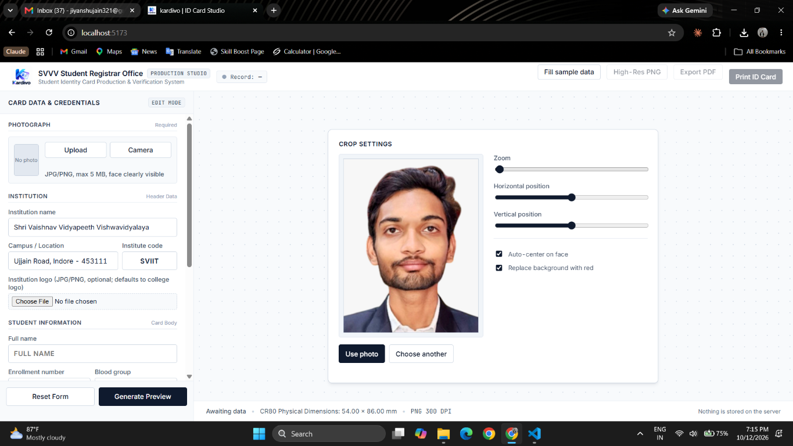
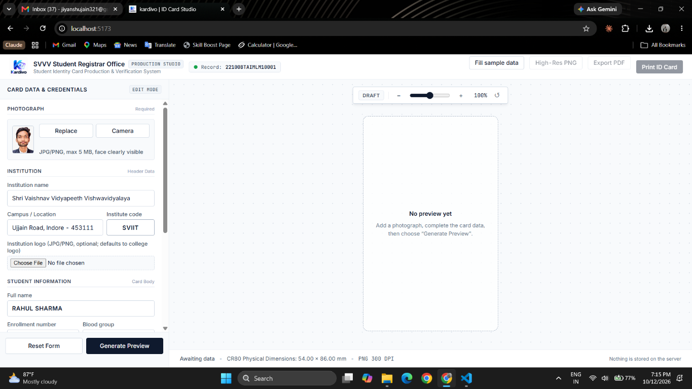
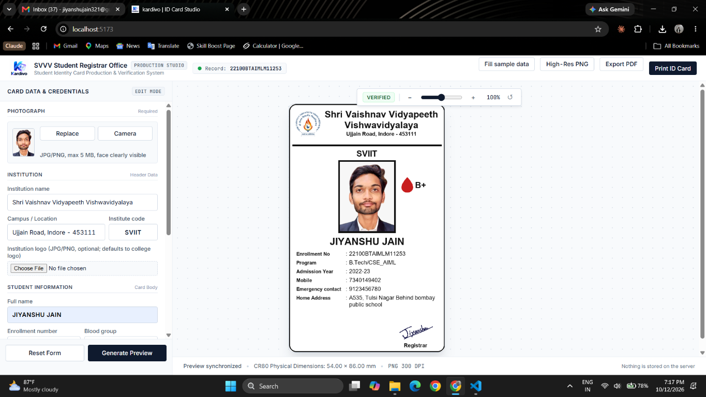
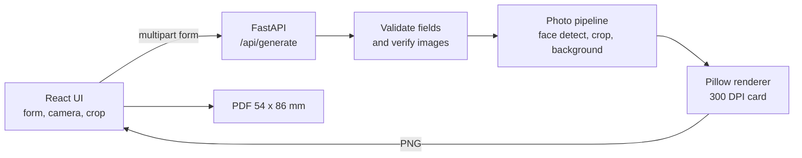

# Kardivo


**A browser-based university ID card studio.** Fill in student details, crop a photo, and export a print-ready CR80 card (54 x 86 mm) as a 300 DPI PNG or PDF. Nothing is stored on the server.

**[Live demo](https://kardivo-zeta.vercel.app/)** | [API health check](https://kardivo.onrender.com/)

> The API runs on a free Render instance, so the first request after idle time can take 30-60 seconds (cold start).

## Why this project

Registrar offices often produce ID cards by hand in design tools, which is slow and error-prone. Kardivo replaces that with a validated form, a consistent layout and print-accurate output, and it never persists sensitive student data.

## Screenshots

<table>
  <tr>
    <td align="center" width="50%">
      <br>
      <sub><b>1. Photo crop and adjustment</b></sub>
    </td>
    <td align="center" width="50%">
      <br>
      <sub><b>2. Student and institution form</b></sub>
    </td>
  </tr>
  <tr>
    <td align="center" width="50%">
      <br>
      <sub><b>3. Card preview workspace</b></sub>
    </td>
    <td align="center" width="50%">
      <br>
      <sub><b>4. Generated card (sample data)</b></sub>
    </td>
  </tr>
</table>

## Features

- Guided data entry with inline validation on both client and server
- Photo input via JPG/PNG upload or live camera capture
- Crop, zoom and position controls, with optional face auto-centering and red-background replacement
- Optional institution logo (defaults to the bundled college logo) and registrar signature
- On-demand preview with zoom and an "Outdated" indicator when the form changes after generation
- Export as 300 DPI PNG or 54 x 86 mm PDF, or print straight from the browser
- In-memory processing: uploads and generated cards are never written to disk

## How it works



## Technical highlights

| Area | What it does |
| --- | --- |
| Face-aware cropping | OpenCV Haar cascade finds the largest face and crops a 7:9 passport-ratio box around it. Faces smaller than 40% of the largest are ignored. If OpenCV is unavailable the card still renders and the API returns a warning. |
| Background replacement | Samples edge pixels, takes the median colour, and builds a blurred colour-distance mask to swap the background for red. |
| Signature cleanup | Scans on white paper are converted to transparent-background ink automatically. |
| Adaptive layout | Text is auto-shrunk and word-wrapped (long words are split) so names, addresses and institution names never overflow the card. |
| Print accuracy | Card is rendered at exactly 638 x 1016 px (54 x 86 mm at 300 DPI); the PDF page matches that physical size. |
| Input hardening | Control characters stripped, per-field regex validation on client **and** server, uploads verified with Pillow, JPG/PNG only, 5 MB cap per image, request body size limit. |
| Privacy | Everything is processed in memory, responses send `Cache-Control: no-store`, and personal data is not logged. |

## Design decisions

- **Server-side rendering with Pillow** instead of canvas/HTML-to-image, so output is identical across browsers and devices and is not affected by the user's fonts or screen DPI.
- **Two endpoints:** `/api/preview` is lenient and half-resolution for fast feedback; `/api/generate` is strict and print quality, so incomplete forms never block the preview.
- **Stateless backend:** no database, no storage, no sessions. This keeps the privacy story simple and makes the service trivially horizontally scalable.
- **Optional OpenCV:** face detection degrades gracefully to a centre crop with a warning instead of failing the request.

## Known limitations

Documented honestly so reviewers know what is intentional:

- **No automated tests or CI yet** (top of the roadmap).
- **No rate limiting or auth** on a CPU-heavy endpoint. Fine for a demo; a production deployment would need a limiter and a queue.
- **Body-size limit uses the `Content-Length` header**, so it is a first line of defence, not a hard guarantee against chunked uploads. The 5 MB per-image read cap is the real limit.
- **CORS allows any `*.vercel.app` origin** (to support preview deployments). Lock `ALLOWED_ORIGINS` down for production.
- **Fonts are resolved from system paths** (DejaVu, Arial, Liberation). Output can differ on hosts without them; bundling a font file is planned.
- **Single-institution defaults:** the bundled logo and address belong to one college. Institution name, address, code and logo are overridable per card.

## Tech stack

- **Frontend:** React 19, Vite 8, Oxlint
- **Backend:** FastAPI, Pillow, NumPy, OpenCV (optional)
- **Hosting:** Vercel (frontend), Render (backend)

## Project structure

```text
.
├── backend/
│   ├── id_card.py          # Card rendering (Pillow) and photo processing
│   ├── main.py             # FastAPI app, validation, endpoints
│   ├── requirements.txt
│   └── svvv.png            # Default institution logo
├── frontend/
│   ├── public/
│   │   └── kardivo-logo.png
│   ├── src/
│   │   ├── main.jsx
│   │   ├── App.jsx
│   │   └── component/
│   │       ├── hero.jsx        # Main studio UI, camera, crop, export
│   │       ├── details.jsx     # Form sections
│   │       └── validation.js   # Client-side validation rules
│   ├── package.json
│   └── vite.config.js
├── docs/
│   └── screenshots/
└── README.md
```

## Run locally

**Requirements:** Python 3.10+, Node.js 20.19+ or 22.12+ (required by Vite 8), npm.

### 1. Backend

<details open>
<summary>Windows (PowerShell)</summary>

```powershell
cd backend
python -m venv .venv
.\.venv\Scripts\Activate.ps1
pip install -r requirements.txt
uvicorn main:app --reload --port 8000
```

</details>

<details>
<summary>macOS / Linux</summary>

```bash
cd backend
python3 -m venv .venv
source .venv/bin/activate
pip install -r requirements.txt
uvicorn main:app --reload --port 8000
```

</details>

API runs at `http://localhost:8000`.

### 2. Frontend

In a second terminal:

```bash
cd frontend
npm install
npm run dev
```

Open `http://localhost:5173`. To point the UI at a local API:

```powershell
$env:VITE_API_URL = "http://localhost:8000"   # PowerShell
```

```bash
export VITE_API_URL=http://localhost:8000      # macOS / Linux
```

### Configuration

| Variable | Where | Default | Purpose |
| --- | --- | --- | --- |
| `VITE_API_URL` | Frontend | `https://kardivo.onrender.com` | Backend base URL |
| `ALLOWED_ORIGINS` | Backend | `http://localhost:5173,http://127.0.0.1:5173` | Comma-separated CORS origins |

Deployed values:

```text
VITE_API_URL=https://kardivo.onrender.com
ALLOWED_ORIGINS=https://kardivo-zeta.vercel.app,http://localhost:5173,http://127.0.0.1:5173
```

### Frontend commands

```bash
npm run dev      # Dev server
npm run build    # Production build
npm run lint     # Oxlint
npm run preview  # Preview production build
```

## API

Both endpoints accept `multipart/form-data`.

| Endpoint | Behaviour |
| --- | --- |
| `GET /` | Health check: `{"status": "ok", "service": "kardivo-api"}` |
| `POST /api/preview` | Lenient, half-resolution PNG preview; tolerates incomplete forms. |
| `POST /api/generate` | Strict validation, then the print-quality card as PNG (300 DPI) or PDF (54 x 86 mm), chosen with the `fmt` field. |

Validation errors return **HTTP 422** with a per-field `errors` object. Oversized uploads return **413**. Non-fatal photo issues (no face, multiple faces) come back in the `X-Warnings` header, separated by `|`.

Example:

```bash
curl -X POST https://kardivo.onrender.com/api/generate \
  -F college_code=SVVV -F name="RIYA SHARMA" -F blood_group="B+" \
  -F enrollment=22100BTCSE001 -F program="B.Tech CSE" -F admission_year=2022-23 \
  -F mobile=9876543210 -F emergency=9123456780 -F address="Indore, MP" \
  -F fmt=png -F photo=@photo.jpg -o id-card.png
```

### Input rules

| Field | Rule |
| --- | --- |
| Institute code | Required; letters, numbers, spaces, hyphens; max 12 characters |
| Name | Letters, spaces and dots; max 40 characters (uppercased) |
| Blood group | One of A+, A-, B+, B-, AB+, AB-, O+, O- |
| Enrollment number | Alphanumeric, required |
| Program | Required; max 30 characters |
| Admission year | `YYYY-YY` with consecutive years, e.g. `2022-23` |
| Mobile / emergency contact | 10-digit Indian mobile number (starts with 6-9); must differ from each other |
| Address | Required; max 120 characters |
| Images | JPG or PNG, max 5 MB each; photo required, logo and signature optional |

## Roadmap

- [ ] Automated tests for validation and card rendering (pytest, plus a golden-image check)
- [ ] GitHub Actions CI: lint, build, tests
- [ ] Docker Compose for one-command local run
- [ ] Rate limiting and bundled fonts
- [ ] Bulk generation from CSV
- [ ] QR code or barcode for card verification

## Privacy

The backend processes uploaded images and generated cards in memory only. It does not persist personal data, uploads or output to disk, and responses are sent with `Cache-Control: no-store`. Use sample data when testing the public demo.

## Author

**Jiyanshu Jain** - [Portfolio](https://jiyanshu.dev) | [LinkedIn](https://www.linkedin.com/in/jiyanshu-jain) | [GitHub](https://github.com/jiyanshuj)