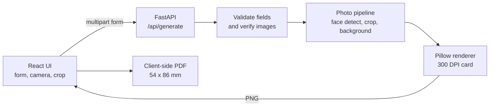

# Kardivo


**A browser-based university ID card studio.** Enter student details, crop a photograph, and export a print-ready CR80 card (54 x 86 mm) as a 300 DPI PNG or a PDF. Nothing is stored on the server.

Built as a full-stack project: a React/Vite frontend for data entry and photo editing, and a FastAPI backend that validates input and renders the card with Pillow, NumPy and OpenCV.

## Live deployment

- **Frontend:** [kardivo-zeta.vercel.app](https://kardivo-zeta.vercel.app/)
- **Backend health check:** [kardivo.onrender.com](https://kardivo.onrender.com/)
- **Preview API:** `https://kardivo.onrender.com/api/preview`
- **Generate API:** `https://kardivo.onrender.com/api/generate`

The deployed frontend uses the Render backend as its API base URL. For a separate
deployment, set `VITE_API_URL` to the backend URL and configure the backend
`ALLOWED_ORIGINS` value with the frontend origin.

## Why this project

Registrar offices often produce ID cards by hand in design tools, which is slow and error-prone. Kardivo replaces that with a validated form, consistent layout and print-accurate output, and it handles sensitive student data without persisting it.

## Features

- Guided student and institution data entry with inline validation on both client and server
- Photo input by JPG/PNG upload or live camera capture
- Crop, zoom and positioning controls, with optional face auto-centering and red-background replacement
- Optional institution logo (defaults to the bundled college logo) and registrar signature
- Card preview generated on demand, with zoom controls and an "Outdated" indicator when the form changes after generation
- Export as 300 DPI PNG or a 54 x 86 mm PDF, or print directly from the browser
- In-memory processing: uploaded images and generated cards are never written to disk

## Screenshots

<p align="center">
  <br>
  <em>Photo crop and adjustment</em>
</p>

<p align="center">
  <br>
  <em>Student and institution form</em>
</p>

<p align="center">
  <br>
  <em>Card preview workspace</em>
</p>

<p align="center">
  <br>
  <em>Generated ID card (sample data)</em>
</p>

## How it works



## Technical highlights

- **Face-aware cropping:** OpenCV Haar cascade finds the largest face and crops a 7:9 passport-ratio box around it. If OpenCV is unavailable, the card still renders and the API returns a warning.
- **Background replacement:** samples the photo's edge pixels, takes the median colour, and builds a blurred colour-distance mask to swap the background for red.
- **Signature cleanup:** scanned signatures on white paper are converted to transparent-background ink automatically.
- **Adaptive layout:** text is fitted and word-wrapped to the card so long names, addresses and institution names never overflow.
- **Dependency-free PDF export:** the frontend writes a single-page PDF of exactly 54 x 86 mm around the rendered image, with no PDF library.
- **Defence in depth:** field validation runs in the browser and again on the server; uploads are verified with Pillow, type-checked (JPG/PNG only) and capped at 5 MB, and request bodies are size-limited.
- **Privacy by design:** all processing happens in memory, responses use `Cache-Control: no-store`, and personal data is not logged.

## Tech stack

- Frontend: React 19, Vite 8, Oxlint
- Backend: FastAPI, Pillow, NumPy, OpenCV (face detection is optional; the card still renders without it)

## Project structure

```text
.
├── backend/
│   ├── id_card.py          # Card rendering (Pillow) and photo processing
│   ├── main.py             # FastAPI app, validation, endpoints
│   ├── requirements.txt
│   └── svvv.png            # Default institution logo
├── frontend/
│   ├── public/
│   │   └── kardivo-logo.png
│   ├── src/
│   │   ├── main.jsx
│   │   ├── App.jsx
│   │   └── component/
│   │       ├── hero.jsx        # Main studio UI, camera, crop, export
│   │       ├── details.jsx     # Form sections
│   │       └── validation.js   # Client-side validation rules
│   ├── package.json
│   └── vite.config.js
├── docs/
│   └── screenshots/
└── README.md
```

## Requirements

- Python 3.10 or newer
- Node.js 20.19+ or 22.12+ (required by Vite 8)
- npm

## Run locally

### 1. Start the backend

From the repository root:

**Windows (PowerShell)**

```powershell
cd backend
python -m venv .venv
.\.venv\Scripts\Activate.ps1
pip install -r requirements.txt
uvicorn main:app --reload --port 8000
```

**macOS / Linux**

```bash
cd backend
python3 -m venv .venv
source .venv/bin/activate
pip install -r requirements.txt
uvicorn main:app --reload --port 8000
```

The API is available at `http://localhost:8000`.

### 2. Start the frontend

In a second terminal:

```bash
cd frontend
npm install
npm run dev
```

Open `http://localhost:5173`.

### Configuration

| Variable | Where | Default | Purpose |
| --- | --- | --- | --- |
| `VITE_API_URL` | Frontend | `https://kardivo.onrender.com` | Backend base URL |
| `ALLOWED_ORIGINS` | Backend | `http://localhost:5173,http://127.0.0.1:5173` | Comma-separated CORS origins |

Example (PowerShell):

```powershell
$env:VITE_API_URL = "http://localhost:8000"
npm run dev
```

For the deployed services, use:

```text
VITE_API_URL=https://kardivo.onrender.com
ALLOWED_ORIGINS=https://kardivo-zeta.vercel.app,http://localhost:5173,http://127.0.0.1:5173
```

## Frontend commands

Run from `frontend/`:

```bash
npm run dev      # Start the development server
npm run build    # Create a production build
npm run lint     # Run Oxlint
npm run preview  # Preview the production build
```

## API

Both endpoints accept multipart form data.

- `POST /api/generate` - strictly validates the form and returns the print-quality card as PNG (300 DPI) or PDF (54 x 86 mm), selected with the `fmt` field. The web app uses this endpoint for previews and exports.
- `POST /api/preview` - lenient, lower-resolution PNG preview that tolerates incomplete forms.

Validation errors return HTTP 422 with a per-field `errors` object. Non-fatal photo issues (no face found, multiple faces) are returned in the `X-Warnings` response header.

### Input rules

| Field | Rule |
| --- | --- |
| Name | Letters, spaces and dots; max 40 characters |
| Enrollment number | Alphanumeric, required |
| Admission year | `YYYY-YY`, e.g. `2022-23` |
| Mobile / emergency contact | 10-digit Indian mobile number (starts with 6-9); must differ from each other |
| Address | Required; max 120 characters |
| Images | JPG or PNG, max 5 MB each |

## Roadmap

- Automated tests for validation and card rendering
- Docker Compose setup for one-command local run
- Bulk generation from a CSV file
- QR code or barcode for card verification

## Privacy

The backend processes uploaded images and generated cards in memory only. It does not persist personal data, uploads or generated output to disk, and responses are sent with `Cache-Control: no-store`.

## Author

**Jiyanshu Jain** - [Portfolio](https://jiyanshu.dev) | [LinkedIn](https://www.linkedin.com/in/jiyanshu-jain) | [GitHub](https://github.com/jiyanshuj)